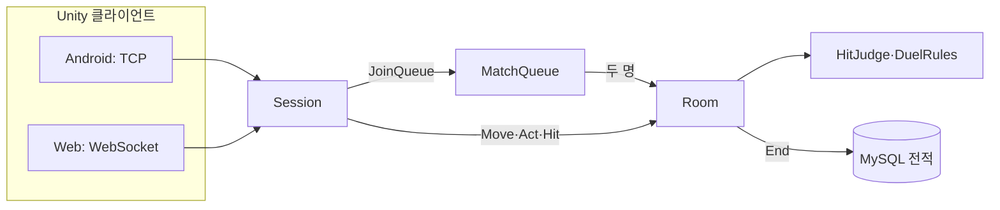

# 온라인 1:1 대전 설계 (초안, 2026-11-16)

타이틀의 「1:1 대전」은 지금 사람처럼 보이는 AI와 싸운다(`Story.Duel`, `DuelRival.PickAi`). 이 문서는 그 자리에 진짜 상대를 붙이는 서버와 클라이언트 변경을 설계한다.

## 1. 목표와 범위

- **만드는 것**: C#(.NET) 대전 서버, 게스트 로그인, 매칭, 실시간 1:1 대전, 전적. 안드로이드와 웹 데모에서 서로 싸울 수 있다.
- **만들지 않는 것**: 채팅, 친구, 시즌 랭킹, 결제, 관전.
- **보여 주려는 것**: C# 서버 공고(2026-11-16 사용자가 보여 준 공고)의 필수·우대 조건을 한 프로젝트로 보인다.

| 공고 | 이 설계에서 |
|---|---|
| C# 서버, 비동기·멀티스레드 | .NET 10 서버, `async`/`await` 수신 루프, 방을 맡는 작업 스레드(4장) |
| TCP/UDP, Socket, Packet, Session | TCP 소켓 위 패킷 경계 처리(`System.IO.Pipelines`), 손으로 짠 직렬화, 세션 수명(3장) |
| Unity 서버 연동, 상태 동기화 | 상대 위치 보간, 서버가 정하는 체력·승패(2장, 6장) |
| MySQL, Redis | 계정·전적(MySQL), 매칭 대기열·서버 목록(Redis) |
| 분산 서버, 서버 간 통신, 대규모 동시 접속 | 로비와 대전 서버를 나누고, 봇 클라이언트로 부하 시험(7장 3단계) |
| Actor Model, Orleans | 방 하나를 한 스레드만 만지는 액터식 구조. Orleans로 옮길 수 있는 모양(4장) |
| 로그·모니터링 | 경기 id가 붙은 구조화 로그, 접속·방·틱 시간 지표 |

## 2. 핵심 결정

### 2.1 판정: 이동은 클라이언트가, 체력·승패는 서버가

| 정하는 것 | 누가 | 서버가 막는 부정 |
|---|---|---|
| 내 캐릭터의 이동 | 내 클라이언트(지금 전투 코드 그대로) | 속도·투기장 밖. 어기면 서버 위치로 되돌린다 |
| 스킬을 쓸 수 있는지 | 서버 | 쿨다운, 고르지 않은 판도라, 궁극기 게이지 |
| 맞았는지 | 때린 쪽이 알리고 서버가 검사 | 사거리, 스킬이 살아 있는 시간, 타수 |
| 피해량, 체력, 승패 | 서버 | 서버가 공식(`DamageFormula`)과 난수를 굴린다 |

**버린 안**
- **서버가 전투를 통째로 돌리기**: 정석이지만 전투 코드(`FieldCombat`, `PlayerSkills` 등 약 3,000줄)가 `MonoBehaviour`와 `Physics2D`에 묶여 있다. 엔진 없는 코어로 떼어 내는 일이 서버보다 크다. 4단계로 미룬다.
- **입력만 주고받는 락스텝**: 두 기기가 같은 결과를 내야 하는데, 안드로이드(ARM)와 웹(WebAssembly)의 부동소수와 `Physics2D`가 같다는 보장이 없다.
- **맞은 쪽이 판정**: 맞았다고 알리지 않으면 무적이 된다. 서버가 「안 알린 것」을 검사할 수 없다.

### 2.2 전송: 안드로이드는 TCP, 웹은 WebSocket

- 브라우저는 TCP·UDP 소켓을 직접 열 수 없다. 웹 데모가 포트폴리오의 얼굴이라 WebSocket이 꼭 있어야 한다.
- 안드로이드와 에디터는 TCP 소켓을 직접 쓴다. 패킷 경계를 직접 처리해야 해서 소켓 공부가 그대로 드러난다.
- 서버의 패킷 층은 전송과 상관없다. 두 전송 모두 같은 패킷을 주고받는다.
- **UDP를 안 쓰는 이유**: 브라우저에서 못 쓰고, 1:1에 초당 20번 작은 패킷이면 TCP로 충분하다. 잃은 패킷 하나가 뒤를 막는 문제(head-of-line blocking)는 안고 간다. 끊김이 심하면 4단계에서 안드로이드만 UDP(KCP 등)를 시험한다.
- 웹 페이지가 https라 서버도 TLS(`wss://`)여야 한다. 그래서 도메인이 필요하다(8장).

### 2.3 서버는 Unity가 아니라 .NET 10

- Unity 헤드리스 서버는 전투 코드를 그대로 쓸 수 있지만, 무겁고 소켓·스레드를 엔진이 감춘다. 공고가 보려는 것은 순수 C# 서버다.
- .NET 10은 LTS다(.NET 8 지원은 2026-11-10에 끝났다). 이 PC에 SDK 10.0.401이 깔려 있다.
- ASP.NET Core 호스트 하나로 HTTP(로그인·상태 확인), WebSocket, TCP(Kestrel `ConnectionHandler`)를 함께 받는다.

### 2.4 규칙의 정본은 그대로 `Data/` 에셋

- 서버도 쿨다운, 위력, 사거리, 타수, 대전 능력치(장 레벨 7, 판도라 레벨 10)를 알아야 한다.
- 서버가 Unity 에셋을 읽을 수 없으니, 에디터 메뉴 `Export Duel Rules`가 `Server/rules/duel_rules.json`을 뽑는다. 에셋과 JSON이 어긋나면 EditMode 테스트가 잡는다.
- `DamageFormula`와 `JsMath`는 이미 엔진을 쓰지 않는다. 자리를 옮기지 않고 서버 프로젝트가 그 파일을 링크해 함께 컴파일한다(0단계에서 정함: 옮기면 네임스페이스가 바뀌어 쓰는 곳 아홉 군데를 고쳐야 하고, 링크로도 같은 코드를 쓴다는 목적은 이룬다). 두 파일에 엔진 코드를 넣으면 서버 빌드가 깨져서 바로 알 수 있다.

## 3. 프로토콜

### 3.1 공유 어셈블리

- `Assets/MiniPandoras/Scripts/Protocol/`(네임스페이스 `MiniPandoras.Protocol`)에 `asmdef`를 두고 `noEngineReferences: true`로 엔진 참조를 막는다.
- 서버 프로젝트는 같은 파일을 링크로 컴파일한다(`<Compile Include="../../Assets/MiniPandoras/Scripts/Protocol/**/*.cs" />`).
- Unity는 C# 9라서 공유 코드는 C# 9 문법만 쓴다(파일 범위 네임스페이스, `required` 금지).
- 네임스페이스 층의 맨 아래(Dialogue와 같은 층)에 둔다.

### 3.2 패킷 모양

```
| 길이 ushort | 번호 ushort | 본문 … |      리틀 엔디언, 길이는 머리말 4바이트를 뺀 본문 길이
```

- 본문은 손으로 짠 `PacketWriter`/`PacketReader`(`Span<byte>`, `BinaryPrimitives`)로 쓴다. 외부 직렬화 라이브러리를 쓰지 않는 이유: 패킷이 열다섯 개 남짓이라 직접 짜도 짧고, 직렬화를 이해한다는 것을 보일 수 있다.
- TCP는 바이트가 쪼개지거나 붙어서 온다. 서버는 `PipeReader`로 머리말이 다 올 때까지 기다리고, 본문 길이만큼 모이면 한 패킷으로 자른다. WebSocket은 메시지 하나가 패킷 하나다.
- 버퍼는 `ArrayPool<byte>`에서 빌린다. 틱마다 새로 할당하지 않는다.
- 첫 패킷 `Hello`에 프로토콜 버전을 넣는다. 다르면 서버가 `Error(VersionMismatch)`로 닫고, 클라이언트는 업데이트를 안내한다.

### 3.3 패킷 목록 (1단계)

| 방향 | 패킷 | 내용 |
|---|---|---|
| C→S | `Hello` | 프로토콜 버전, 로그인 토큰, 닉네임(계정이 없는 1단계에서 쓴다) |
| C→S | `JoinQueue` / `LeaveQueue` | 고른 판도라 id 셋 |
| C→S | `Ready` | 투기장을 다 불렀다 |
| C→S | `Move` | 순번, 클라이언트 프레임, 발 위치, 방향, 동작(서기·걷기·휘두르기·돌진…) |
| C→S | `Act` | 순번, 종류(공격·스킬·판도라 교체·궁극기), 스킬 id, 겨냥 방향 |
| C→S | `Hit` | 어느 `Act`의 몇 번째 타격이 상대에게 닿았는지 |
| C↔S | `Ping` / `Pong` | 왕복 시간과 서버 시계 맞추기 |
| S→C | `Welcome` | 플레이어 id, 닉네임 |
| S→C | `MatchFound` | 경기 id, 상대 닉네임·판도라·전적 |
| S→C | `Start` | 시작 서버 시각(3초 세기) |
| S→C | `RivalMove` / `RivalAct` | 상대의 `Move`·`Act`를 검사한 뒤 그대로 넘긴다 |
| S→C | `Damage` | 누가 몇을 맞았는지, 남은 체력, 넉백·상태이상 |
| S→C | `Correct` | 속도·위치 검사에 걸렸을 때 서버가 아는 위치 |
| S→C | `End` | 승패, 까닭(쓰러짐·시간 초과·나감), 바뀐 전적 |
| S→C | `Error` | 오류 번호 |

## 4. 서버 구조



- **Session**: 연결 하나. 수신 루프 하나와 송신 루프 하나를 가진다.
  - 보내기는 `Channel`(크기 제한)에 넣고 송신 루프 하나만 소켓에 쓴다. 여러 스레드가 한 소켓에 동시에 쓰지 않게 하려는 것이다.
  - 채널이 가득 차면(느린 클라이언트) 끊는다.
- **Room**: 경기 하나의 상태(두 사람의 위치 기록, 체력, 마나, 쿨다운, 궁극기 게이지)를 가진다.
  - **방은 자기 작업 스레드만 만진다.** 세션이 받은 패킷은 방의 입력 큐에 넣기만 하고, 처리는 방의 틱에서 한다. 그래서 잠금(lock)이 없다. 액터 모델과 같은 생각이다(Orleans라면 방 하나가 grain 하나).
  - 틱은 초당 30번이다. 받은 패킷 처리 → 검사 → 상대에게 넘기기 → 시간 확인.
- **RoomWorker**: 작업 스레드 하나가 방 여러 개를 돌린다. 스레드 수는 CPU 코어 수다. 방마다 타이머를 두는 것보다 방이 많아져도 스레드가 늘지 않는다. 부하 시험(7장 3단계)에서 두 방식을 견준다.
- **MatchQueue**: 1~2단계는 서버 메모리 큐, 3단계는 Redis다. 전적으로 매긴 점수(MMR)가 가까운 사람끼리 짝짓고, 오래 기다릴수록 범위를 넓힌다.
- **경기 수명**: 짝지어짐 → 둘 다 `Ready`(15초 안에 안 오면 취소) → 3초 세기 → 싸움(최대 180초, 시간이 다 되면 남은 체력 비율이 높은 쪽이 이김) → 끝. 시간 제한은 제안이다.
- **끊김**: 싸우는 중에 끊기면 10초 동안 같은 토큰으로 다시 들어올 수 있다(2단계). 못 들어오면 진다.

### 4.1 서버 검사 규칙

| 받은 것 | 검사 | 어기면 |
|---|---|---|
| `Move` | 지난 위치에서 (최대 속도 × 지난 시간 × 1.25) 안인가. 돌진 스킬이 살아 있는 동안은 그 스킬의 거리까지 | `Correct`로 되돌리고 어긴 횟수를 센다 |
| `Move` | 투기장 원 안인가 | 원 안으로 `Correct` |
| `Act` | 고른 판도라의 스킬인가, 쿨다운이 지났나(왕복 지연만큼 봐준다), 마나가 있나, 궁극기 게이지가 찼나 | 무시하고 상대에게 넘기지 않는다 |
| `Hit` | 그 `Act`가 있고, 스킬이 살아 있는 시간 안이고, 타수를 넘지 않았나 | 무시 |
| `Hit` | 최근 300ms 위치 기록 가운데 두 사람이 가장 가까웠던 거리가 (사거리 + 0.5칸) 안인가 | 무시 |

- 통과하면 서버가 `DamageFormula`로 피해를 계산하고 `Damage`를 두 사람에게 보낸다.
- 마나와 궁극기 게이지도 서버가 센다. 규칙은 지금 `UltimateGauge`와 같다(맞힌 일격의 위력만큼, 싸우는 동안 조금씩 저절로). 다만 「맞힌 일격」은 서버가 통과시킨 `Hit`만 친다.
- 어긴 횟수가 많으면 로그에 남긴다. 1단계에서는 끊지 않는다.

### 4.2 폴더

```
Server/
  MiniPandoras.Server.sln
  src/DuelServer/          Program.cs, Net/(TcpHandler, WebSocketEndpoint, Session, PacketFramer),
                           Matching/MatchQueue, Rooms/(Room, RoomWorker, HitJudge, DuelRules),
                           Accounts/(GuestLogin, Tokens), Storage/(MySQL 전적, Redis 대기열)
  tests/DuelServer.Tests/  xUnit
  tools/DuelBot/           봇 클라이언트(통합 시험, 부하 시험)
  rules/duel_rules.json    Unity가 뽑은 규칙
```

- 같은 저장소(`MiniPandoras-2D`)에 둔다. 프로토콜 파일을 함께 쓰기 때문이다. `.gitignore` 허용 목록에 `!/Server/`를 더하고 `bin/`·`obj/`는 뺀다.
- 서버 코드도 이 프로젝트의 코드 규칙을 따른다(`sealed`, Manager·ServiceLocator·이벤트 버스 없음, 인터페이스는 구현이 둘 이상일 때만). 의존성은 생성자로 넘긴다.

## 5. 저장

| 어디 | 무엇 |
|---|---|
| MySQL `players` | 플레이어 id, 기기에서 만든 게스트 id, 닉네임, MMR, 승·패, 만든 때 |
| MySQL `matches` | 경기 id, 두 사람, 판도라, 승자, 까닭, 걸린 시간, 끝난 때 |
| Redis | 매칭 대기열(MMR 정렬 집합), 대전 서버 목록(심장 박동과 만료), 접속 중인 플레이어 |

- 로그인: 기기에서 한 번 만든 무작위 id(`PlayerPrefs`)로 `POST /login` → 서버가 서명한 토큰(HMAC, 만료 있음)을 준다. 구글 로그인은 나중에 붙인다.
- 온라인 전적은 서버가 정본이다. 기기의 `ProfileStore` 전적은 AI 대전용으로 남긴다.

## 6. 클라이언트에서 바꿀 것

- **새 네임스페이스 `MiniPandoras.Online`**: Combat 위, Story 아래 층(Player·Minigames와 같은 층).
  - `DuelConnection`: 접속, 패킷 보내고 받기, 핑. 받은 패킷은 메인 스레드에서 C# 이벤트로 알린다.
  - `IDuelTransport` 구현 둘: `TcpTransport`(안드로이드·에디터, `System.Net.Sockets`), `BrowserSocketTransport`(웹, 직접 짠 작은 `.jslib`로 브라우저 WebSocket을 부른다. 웹에서는 C# 소켓이 안 된다).
- **피해를 주는 곳 두 군데에 갈림길 하나**: 지금 피해는 `PlayerSkills.DamageEnemy`(내가 때림)와 `FieldCombat.DamagePlayer`(내가 맞음) 두 곳으로만 들어간다.
  - Combat에 `IHitAuthority`를 두고 구현을 둘 만든다.
  - `LocalHits`(Combat): 지금처럼 바로 깎는다. 이야기와 AI 대전이 쓴다.
  - `ServerHits`(Online): 내가 때린 것은 `Hit`으로 알리고, 체력은 서버의 `Damage`가 올 때만 깎는다.
- **`RemoteRival`**: 투기장의 상대를 `EnemyAi` 대신 네트워크로 움직인다.
  - 위치는 100ms 늦게 보간한다(받은 위치 둘 사이를 잇는다).
  - 상대의 스킬 그림은 지금 AI 상대가 쓰는 판도라 적판(`PandoraDefinition.RivalPattern`)으로 보인다.
  - **한계**: 적판은 플레이어 스킬과 모양이 조금 다르다. 공격자 화면과 내 화면의 스킬 모양이 어긋날 수 있다. 플레이어 스킬을 누가 쓰든 그릴 수 있게 바꾸는 일은 4단계다.
- **`Duel.Play`**: `DuelRival.PickAi` 대신 `MatchFound`로 `DuelRival`을 만든다. 상대 정보를 이미 `DuelRival` 하나에 모아 두어서 나머지 흐름(매칭 화면 → VS → 투기장 → 결과)은 그대로다.
  - 상대를 오래 못 찾으면 AI 상대로 넘어간다. 표시 방법은 사용자가 정한다(9장).
- 안드로이드 플레이어 설정의 Internet Access를 Require로 둔다(소켓만 쓰면 자동으로 권한이 안 붙을 수 있다).

## 7. 단계

| 단계 | 하는 일 | 끝났다고 보는 기준 | 대략 |
|---|---|---|---|
| 0 (끝, 2026-11-16) | `Protocol` 공유 어셈블리, `Export Duel Rules`, 서버가 `DamageFormula` 링크 | 서버와 Unity가 같은 패킷 파일로 빌드되고 왕복 테스트 통과 | 1~2일 |
| 1 | 서버 하나(메모리만): 세션, 패킷 경계, 매칭, 방, 검사. 봇 클라이언트. Unity `Online`과 `RemoteRival` | 에디터 두 개(또는 에디터와 봇)가 로컬 서버에서 한 판을 끝까지 싸운다. 봇 둘의 통합 시험 통과 | 5~7일 |
| 2 | MySQL 계정·전적, 토큰, 다시 접속, 웹 WebSocket | 폰과 웹 데모가 서로 싸우고 전적이 서버에 남는다 | 3~4일 |
| 3 | 로비와 대전 서버 나누기, Redis 대기열·서버 목록, 지표, 봇 1,000 세션 부하 시험 | 부하 시험 결과(동시 방 수, 틱 시간, CPU, 메모리)를 문서에 남긴다 | 4~6일 |
| 4 (선택) | 전투 코어를 엔진 밖으로 떼어 서버가 돌리기, 또는 안드로이드 UDP | 사용자가 정한다 | - |

- 1단계만 끝나도 소켓, 패킷, 세션, 비동기, 방 구조를 보일 수 있다. 지원 일정에 맞춰 끊어 낼 수 있다.

## 8. 운영과 출시

- **배포**: 작은 리눅스 VM 하나에 Docker Compose(서버, MySQL, Redis, TLS를 붙이는 Caddy). 웹 데모가 https라 `wss://`가 필요하고, 그래서 도메인이 필요하다.
- **로그**: 경기 id와 플레이어 id가 붙은 구조화 로그. **지표**: 접속 수, 방 수, 틱 시간, 초당 패킷(`System.Diagnostics.Metrics`, 3단계에서 Prometheus·Grafana).
- **Google Play**: 온라인을 넣으면 데이터 보안 양식과 개인정보처리방침에 닉네임, 앱이 만든 id, 전적을 적어야 한다.

## 9. 사용자가 정할 것

1. **상대가 없을 때**: AI로 넘어가며 「AI」라고 보일지, 지금처럼 사람처럼 보일지. 진짜 온라인이 생기면 사람인 척하는 AI는 속이는 것이 되어 「AI」 표시를 권한다.
2. **서버 비용과 도메인**: VM은 무료 등급(Oracle Cloud 등)이나 월 몇천 원짜리. 도메인은 연 1~2만 원.
3. **Docker Desktop 설치**: 로컬에서 MySQL·Redis를 띄우는 데 쓴다(2단계부터).
4. **4단계를 할지**: 서버가 전투를 통째로 돌리게 할지.

## 10. 만들기 전에 확인할 것

- `EnemyFighter`를 `EnemyAi` 없이 바깥에서 움직일 수 있는지, 적판 스킬을 AI 판단 없이 바로 쓰게 할 수 있는지.
- 돌진·넉백처럼 위치가 크게 바뀌는 스킬의 목록과 거리(이동 검사의 예외로 쓴다).
- 플레이어 스킬마다 「살아 있는 시간」과 타수를 데이터에서 뽑을 수 있는지. 코드에만 있는 값은 `Data/`로 옮긴 뒤에 내보낸다.
- 0단계에서 찾은 것: 피해 규칙의 몇 값은 데이터가 아니라 코드에 있다. 서버가 쓰기 전에 `Data/Resources/GameBalance`로 옮기고 규칙 파일에 넣는다.
  - 치명타 1.5배, 치명타 확률은 공격한 쪽의 것(`PlayerSkills.DamageEnemy`)
  - 맞은 뒤 무적 50프레임, 경직 12프레임, 넉백은 6프레임에 나눠 밀림(`FieldCombat.DamagePlayer`)
  - 기본 공격 위력 1, 콤보 마지막 1.45와 넉백 4·10px(`FieldCombat`)
  - 지금은 플레이어 → 적, 적 → 플레이어의 규칙이 다르다(적은 가드·포이즈, 플레이어는 무적 시간·흘려보내기). 대전은 두 사람 다 「맞는 플레이어」 규칙을 쓴다.
