<div align="center">

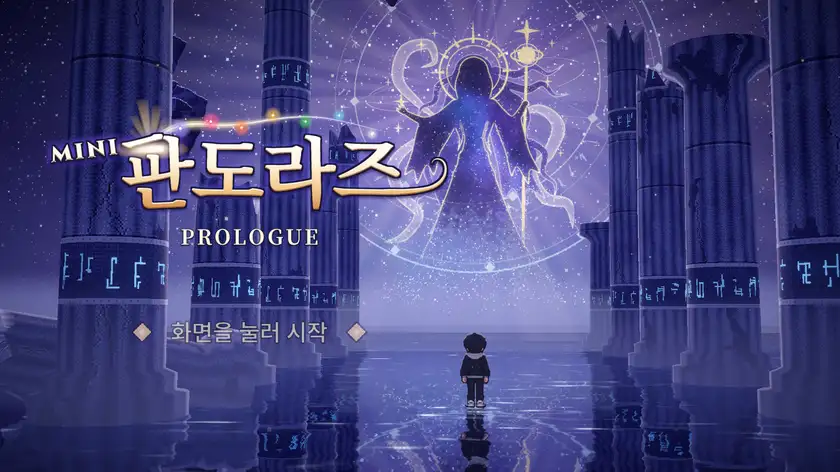

# MINI 판도라즈

직접 만든 웹게임을 Unity로 옮기고, 도트 그림을 입체 무대에 세운 **HD-2D 액션 RPG**입니다.<br>
휴대폰 가로 화면에 맞췄고, 프롤로그부터 11장 엔딩까지 끝까지 할 수 있습니다.


[**플레이 영상과 상세 설명**](https://hyeonsik-game-portfolio.vercel.app/projects/minipandoras/) · [코드 구조](Docs/ARCHITECTURE.md) · [로드맵](Docs/ROADMAP.md) · [외부 자료](Docs/THIRD_PARTY.md)

</div>

## 어떤 게임인가요

차원공간에서 깨어난 주인공이 낯선 세계 에라디온에 떨어집니다. 맵을 걸으며 사람을 만나고, 죽은 신들의 힘인 **판도라**를 모아 싸웁니다.

<table>
<tr>
<td width="50%" align="center">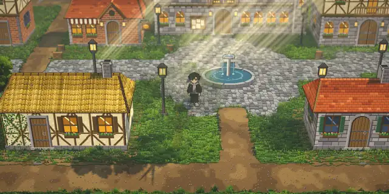<br><b>걷기</b><br>마을, 숲, 사막, 고목 속까지 포탈로 이어진 맵</td>
<td width="50%" align="center">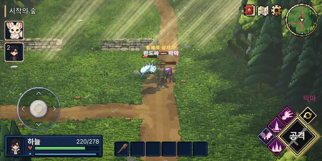<br><b>싸우기</b><br>걷던 맵 위에서 판도라 셋을 바꿔 가며 바로 전투</td>
</tr>
<tr>
<td align="center">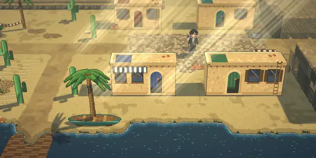<br><b>이야기</b><br>프롤로그와 1~11장, 동료들과 이어 가는 대화</td>
<td align="center">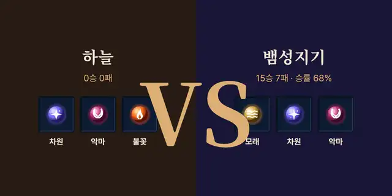<br><b>1:1 대전</b><br>이야기에서 깨운 판도라로 AI 상대와 투기장 승부</td>
</tr>
</table>

조작은 엄지 두 개입니다. 왼손은 누른 자리에 뜨는 조이스틱, 오른손은 앞에 있는 것에 따라 **대화 · 조사 · 공격**으로 바뀌는 버튼 하나와 그 둘레의 스킬 칸입니다.

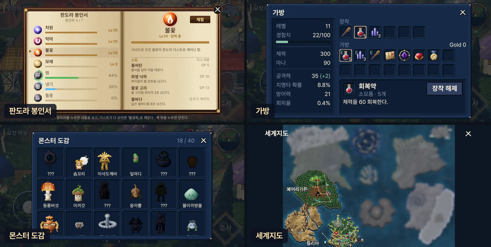

## 그림을 일으켜 세웁니다

2D로 다 만든 게임을 HD-2D로 바꿨습니다. 이동, 충돌, 전투, 이야기는 XY 평면에서 그대로 돌고, **보이는 것만 그 위에 세웁니다.** 그래서 2D에서 맞춘 규칙과 수치를 다시 쓰지 않았습니다.

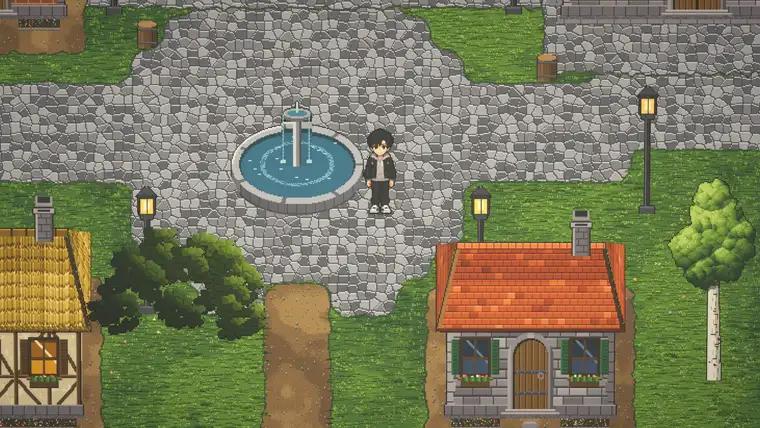

<sub>게임 안에서 찍은 장면입니다. 같은 맵을 눕혀서 본 모습과 세워서 본 모습을 이었습니다.</sub>

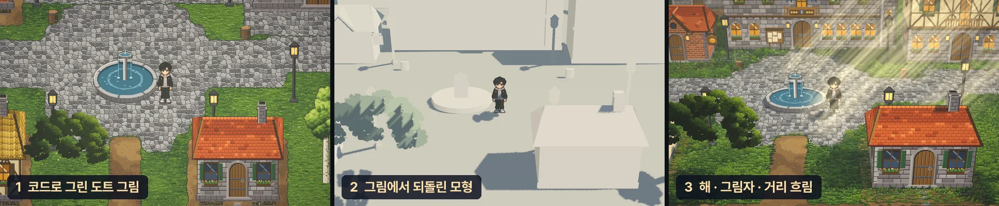

손으로 모델링한 것은 없습니다. 비스듬히 내려다본 그림에서 높이가 h인 점은 발밑보다 h만큼 위에 그려져 있습니다. 그래서 생성기가 점마다 높이를 함께 적어 두면 3D에서 설 자리가 정해집니다.

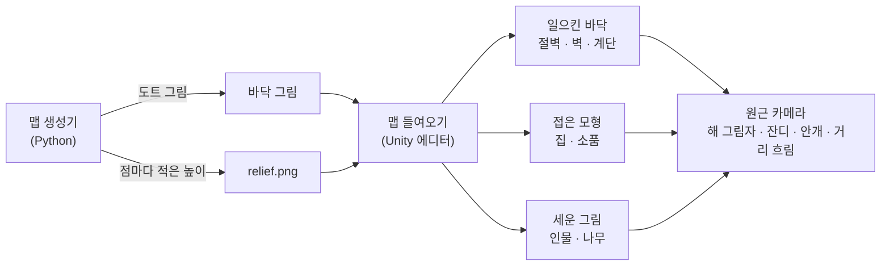

| 무엇을 | 어떻게 | 코드 |
|---|---|---|
| 바닥과 벽 | 높이대로 일으킨 메시. 그림을 텍스처 좌표로 그대로 짚어 도트가 변하지 않음 | [relief.py](Tools/PixelGen/relief.py) · [ReliefMesh.cs](Assets/MiniPandoras/Editor/WebGame/ReliefMesh.cs) |
| 집과 소품 | 그림 한 장을 접힌 지붕과 옆벽이 있는 모형으로 되돌림 | [house_model.py](Tools/PixelGen/house_model.py) · [ModelSheet.cs](Assets/MiniPandoras/Editor/WebGame/ModelSheet.cs) |
| 인물 | 원래 도트 그림을 발밑을 축으로 세우고, 그림자를 그릴 때만 해를 보게 돌림 | [Upright.cs](Assets/MiniPandoras/Scripts/World/Upright.cs) · [SpriteLit3D.shader](Assets/MiniPandoras/Art/Shaders/SpriteLit3D.shader) |
| 가림 | 카메라에서 몸까지 선을 쏘아 실제로 가린 것만 비쳐 보이게 함 | [KeepInSight.cs](Assets/MiniPandoras/Scripts/World/KeepInSight.cs) · [Occluder.cs](Assets/MiniPandoras/Scripts/World/Occluder.cs) |

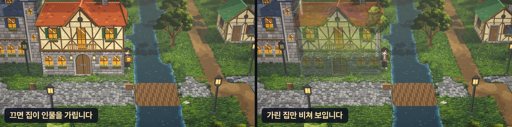

<details>
<summary><b>전과 후를 나란히 보기</b></summary>
<br>
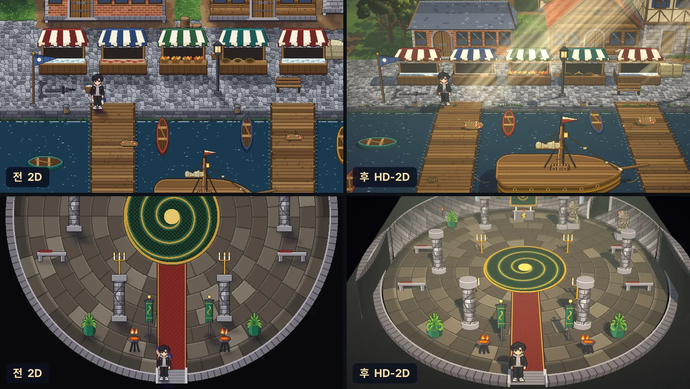
</details>

## 컷인도 실시간 3D 무대입니다

영상 파일 없이, 장면마다 작은 3D 무대를 세우고 그 안에서 카메라를 움직입니다. 아직 만나지 않은 신과 권력자는 얼굴과 옷을 감추고 **윤곽만** 보여 줍니다.

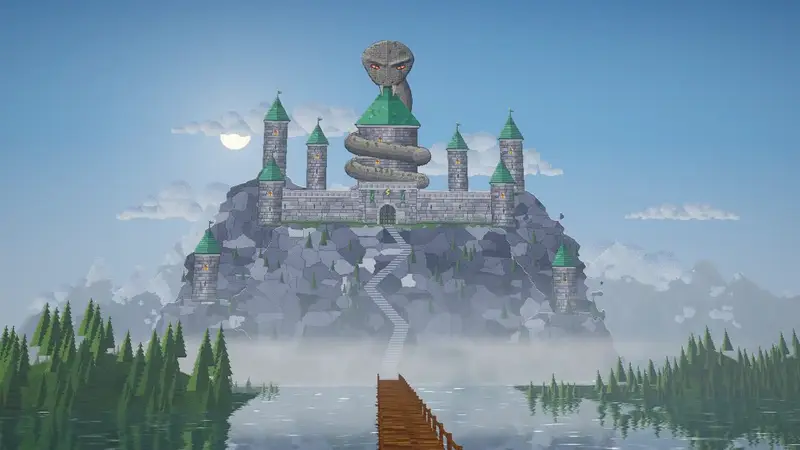

타이틀도 같은 무대입니다. 저장된 이야기가 어디까지 왔는지에 따라 풍경이 바뀌고, 시작을 누르면 무대 안으로 뛰어듭니다.

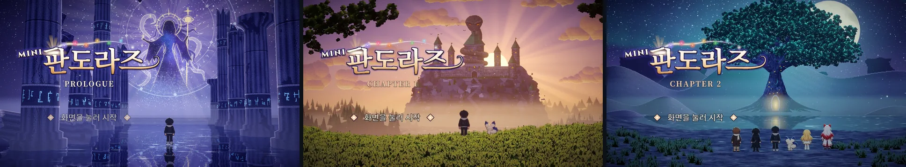

## 장면은 코드로, 글은 파일로

장 하나는 코루틴 하나입니다. 코드에는 **연출의 순서**만 있고, 누가 어떤 말투로 무슨 말을 하는지는 대본 파일에 있습니다.

<table>
<tr>
<td width="54%" valign="top">

```csharp
// Story/Chapter2.cs
s.Scenes.BeginCutIn("castleWide");
yield return s.Field.Warp("castle", "arrive", Facing.Up);
yield return s.FadeIn(24f);
yield return s.Wait(30f);
yield return s.Scenes.CutInMove(240f);
yield return s.Scenes.CutInGlow(1f, 14f);
yield return s.Lines("chapter2.faceTheSnakeCastle.1");
```

```text
# Data/Resources/Text/Chapter2.txt
== chapter2.faceTheSnakeCastle.1
say  hero  우와... 커다란 뱀 모양의 성이다.
say  rang  이 근방에서 가장 큰 성이지.\n사람이 많으니 정보를 얻기엔 좋을 거다.
say  rang  저기에 지도가 떨어져 있는 것 같군.
```

</td>
<td width="46%" valign="top">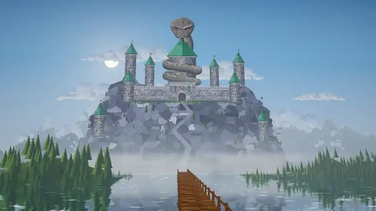<br><sub>왼쪽 코드가 만드는 장면</sub></td>
</tr>
</table>

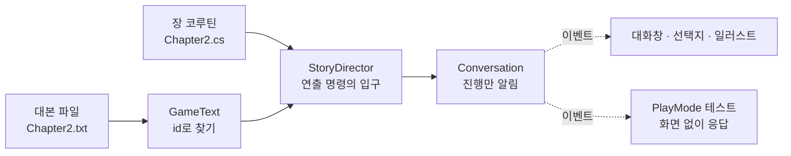

- 대화의 진행(`Conversation`)은 화면을 모릅니다. 대화창과 테스트가 같은 이벤트를 구독해서, 테스트는 화면을 누르지 않고 장을 끝까지 돌립니다.
- 대사의 `{name은}` 자리는 이름의 받침을 보고 조사를 고릅니다([NameFill.cs](Assets/MiniPandoras/Scripts/Dialogue/NameFill.cs)).
- 스킬, 적, 물건, 보스 패턴 같은 수치도 에셋입니다. 코드는 규칙만 갖습니다([Data](Assets/MiniPandoras/Data)).

## 전투는 1/60초씩 셉니다

웹게임 수치가 모두 프레임 단위라서, 실제 시간을 1/60초 틱으로 나눠 셉니다. 프레임이 흔들려도 재사용 대기와 타격 시점이 원본과 같습니다.

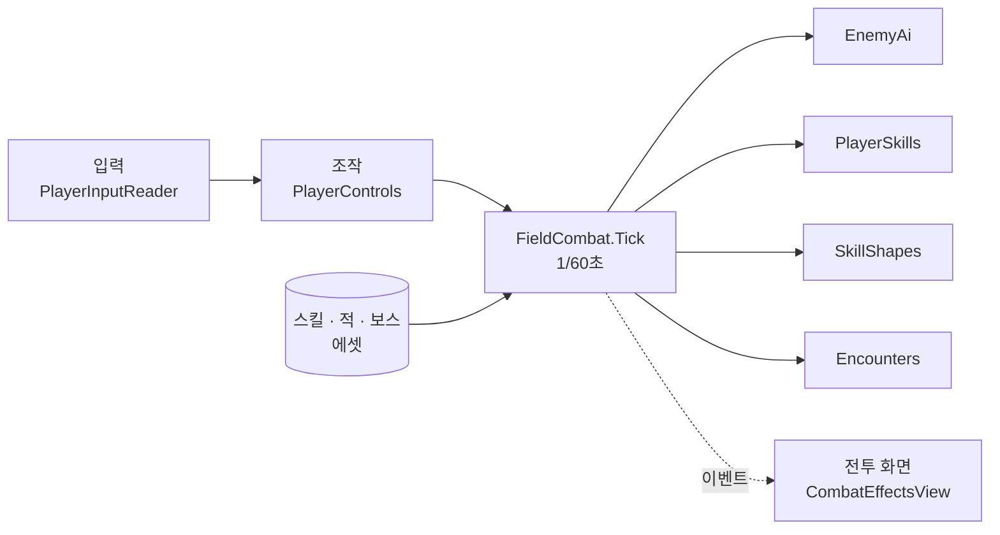

| 맡은 일 | 코드 |
|---|---|
| 한 틱의 순서, 히트스톱, 공격 3연격 | [FieldCombat.cs](Assets/MiniPandoras/Scripts/Combat/FieldCombat.cs) |
| 스킬 모양, 적이 맞기, 동료 부르기 | [PlayerSkills.cs](Assets/MiniPandoras/Scripts/Combat/PlayerSkills.cs) |
| 추격, 돌진, 범위 예고, 무리 | [EnemyAi.cs](Assets/MiniPandoras/Scripts/Combat/EnemyAi.cs) |
| 피해량 공식. 웹게임이 계산한 값과 테스트로 대조 | [DamageFormula.cs](Assets/MiniPandoras/Scripts/Combat/DamageFormula.cs) |

효과와 숫자는 풀에서 꺼내 쓰고, 싸우는 동안 GC 할당이 0인지 테스트가 잽니다.

## 그림도 코드로 그립니다

맵, 집, 소품, 몬스터, 컷인 재료는 Python 생성기([Tools/PixelGen](Tools/PixelGen))가 그립니다. 인물 그림은 웹게임의 것을 씁니다.

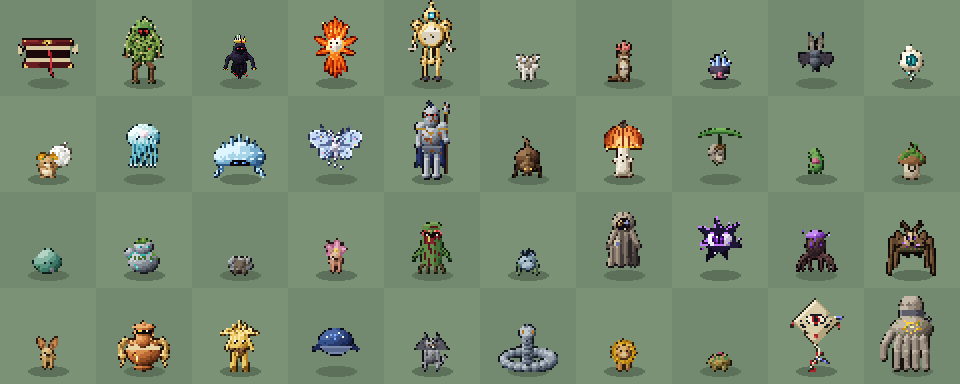

<sub>지형마다 사는 생물과 신의 힘이 깃든 몬스터입니다. 설정은 <a href="Docs/MONSTERS.md">MONSTERS.md</a>에 있습니다.</sub>

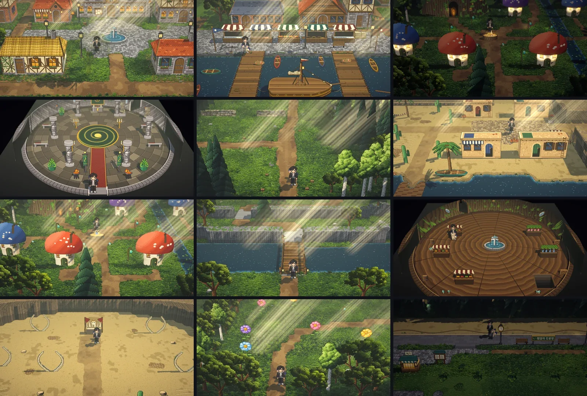

## 코드 구조

네임스페이스가 층을 이룹니다. 아래 층은 위 층을 모르고, 아래에서 위로 알릴 때는 C# 이벤트를 씁니다. 이 규칙은 [NamespaceLayerTests](Assets/MiniPandoras/Tests/EditMode/NamespaceLayerTests.cs)가 검사합니다.

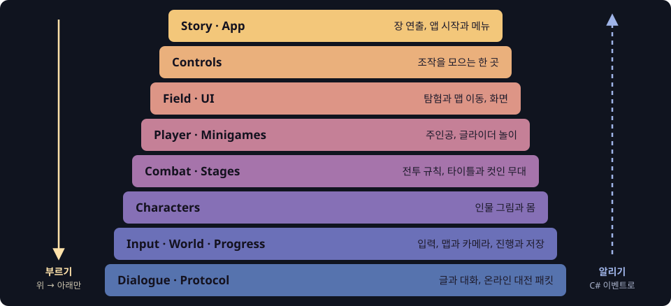

| 규칙 | 까닭 |
|---|---|
| Manager, 이벤트 버스, Base 클래스 계층을 만들지 않음 | 누가 무엇을 부르는지 코드에서 바로 보이게 |
| 인터페이스는 구현이 둘 이상일 때만 | 한 번 더 따라가야 하는 파일을 줄이려고 |
| 큰 클래스는 partial이 아니라 맡은 일별 클래스로 | 파일만 나누면 책임은 그대로라서 |
| UI는 계산하지 않고 이벤트를 구독 | 규칙을 화면 없이 시험하려고 |

테스트는 EditMode 108개와 PlayMode 137개입니다. EditMode는 공식, 저장, 데이터의 빠진 칸과 끊긴 id를 보고, PlayMode는 장마다 처음부터 끝까지 돌려 봅니다.

## 온라인 대전 (만드는 중)

지금 1:1 대전은 AI 상대입니다. 온라인은 설계와 **0단계**(함께 쓰는 패킷, 대전 규칙 내보내기, 서버 틀)까지 했습니다.

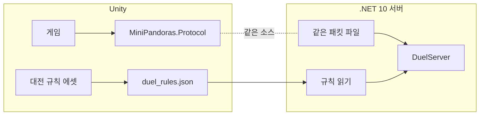

패킷 파일을 게임과 서버가 **같은 소스로** 컴파일해서, 한쪽만 고쳐 어긋나는 일이 없습니다. 설계는 [DESIGN_OnlineDuel.md](Docs/DESIGN_OnlineDuel.md)에 있습니다.

## 저장소 안내

코드, 게임 데이터, 도구, 문서만 올립니다. 맵, 씬, 프리팹, 그림, 외부 에셋은 올리지 않아서 이 저장소만으로는 게임을 실행할 수 없습니다.

| 경로 | 내용 |
|---|---|
| [`Assets/MiniPandoras/Scripts`](Assets/MiniPandoras/Scripts) | 게임 코드. 폴더가 곧 네임스페이스입니다 |
| [`Assets/MiniPandoras/Data`](Assets/MiniPandoras/Data) | 대사, 수치, 표 같은 게임 내용 |
| [`Assets/MiniPandoras/Editor`](Assets/MiniPandoras/Editor) | 맵과 그림 들여오기, 무대 짓기 |
| [`Assets/MiniPandoras/Art/Shaders`](Assets/MiniPandoras/Art/Shaders) | 셰이더 |
| [`Assets/MiniPandoras/Tests`](Assets/MiniPandoras/Tests) | EditMode, PlayMode 테스트 |
| [`Server`](Server) | 온라인 대전 서버(.NET 10) |
| [`Tools/PixelGen`](Tools/PixelGen) · [`Tools/HD2D`](Tools/HD2D) · [`Tools/PixelFx`](Tools/PixelFx) | 맵, 소품, 몬스터, 나무, 이펙트를 그리는 생성기 |
| [`Tools/WebGame`](Tools/WebGame) | 웹게임에서 데이터와 그림을 뽑는 도구 |

- **환경**: Unity 6000.3.25f1, URP, Input System, Test Framework, PrimeTween
- **개발**: 1인 개발. 코드는 Claude Code와 함께 작성했습니다.
- **외부 자료와 라이선스**: [THIRD_PARTY.md](Docs/THIRD_PARTY.md)
